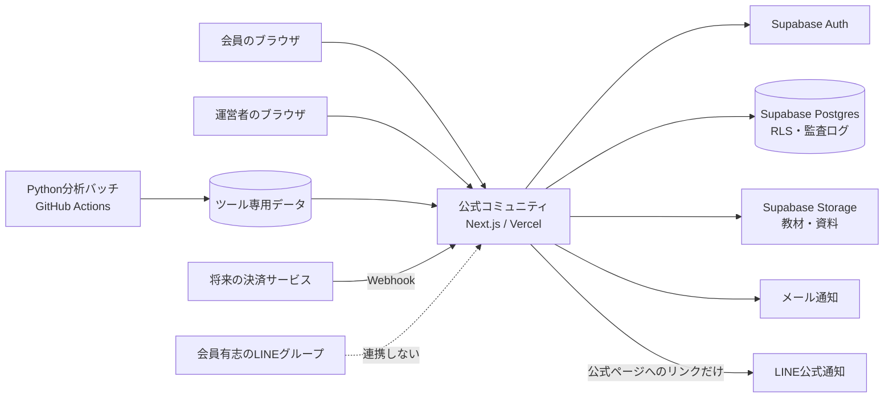

# コミュニティ本格運用：システム・運営統合設計

更新日：2026年10月12日  
対象：日本国内の成人向けコミュニティ／現行の銘柄整理ツールを含む  
状態：実装前の基本設計・運用設計

## 1. 結論

本格版は、現在の銘柄整理ダッシュボードを中心に機能追加するのではなく、**公式コミュニティサイトの中に「銘柄整理ツール」という独立した1機能を置く**形に組み替える。

運用上の正本はVercelで公開するコミュニティサイトとし、会員情報、規約同意、公式告知、教材、イベント、問い合わせ、利用停止、退会をここで管理する。LINEは正本にせず、公式通知または会員有志の交流に限定する。

開始時の重要方針は次のとおり。

1. コミュニティの販売対象は、学習、記録、振り返り、継続支援とする。
2. 銘柄整理ツールは任意機能とし、コミュニティ入会だけでは自動的に有効にしない。
3. 現行スコアロジックは変更しないが、法務確認とデータ利用許諾が終わるまで、有償会員向け機能にはしない。
4. yfinanceは無償PoCの検証用途に限定して継続し、有償開始前に商用利用可能なデータへ切り替える。
5. LINEに会員台帳、規約同意、問い合わせ、決済、個別相談、運営上の最終決定を置かない。
6. Vercel Hobbyは個人・非商用利用に限定されるため、無償PoCでは利用できても、課金、商品広告または事業利用を始める前にProへ切り替える。[Vercel Hobby Plan](https://vercel.com/docs/plans/hobby)

この設計は法的意見書ではない。特に投資助言該当性、データの外部提供権、規約・広告・申込画面は、実際の画面と運用台本を含めて専門家に確認する。

## 2. サービスの境界

### 2.1 公式サービスに含めるもの

- 会員登録、ログイン、パスワード再設定
- 規約・プライバシーポリシーへの同意
- 公式のお知らせ
- 学習教材と週・月単位の課題
- 本人だけが読める学習ノート
- 学習会・振り返り会の日程と参加登録
- 用語、教材、操作に関する質問
- 問い合わせ、退会、返金等の受付
- 運営管理、権限管理、監査記録、障害記録
- 許可された利用者だけが開ける銘柄整理ツール

### 2.2 開始時に含めないもの

- 個別銘柄の購入・売却・保有継続の助言
- 会員ごとに最適化した推奨銘柄、順位、通知
- 講師や運営者の現在の保有銘柄・売買の共有
- 会員同士の自由な銘柄推奨掲示板
- LINE上の個別サポート、契約変更、退会受付
- 証券口座情報、資産額、保有残高の収集
- LINEの表示名、友だち情報、会話内容と会員アカウントの自動連携

金融庁の監督指針は、一連の行為全体で登録要否を判断し、会員登録しなければ使えない投資情報や、個別・相対性の高いインターネット上の投資情報は登録が必要となる場合があると示している。そのため、「コミュニティ会費」「無料特典」「全員に同じ点数」という名称だけでは安全とは扱わない。[金融庁・監督指針 VII](https://www.fsa.go.jp/common/law/guide/kinyushohin/07.html)

## 3. 全体構成

### 3.1 Vercel

- 既存のNext.jsアプリを再利用する。
- コミュニティの画面、認証後ページ、サーバーAPIを配置する。
- ブラウザにはSupabaseの公開用キーだけを渡す。
- service role等の秘密鍵はVercelのサーバー環境変数に置き、ブラウザへ返さない。
- 有償運用前にVercel Proへ変更し、費用上限通知を設定する。

VercelはNext.jsのサーバー表示とAPIをFunctionsとして実行できるため、現在の構成を大きく変えずにコミュニティ機能を増やせる。[Next.js on Vercel](https://vercel.com/docs/frameworks/full-stack/nextjs)

### 3.2 Supabase

- Auth：メールアドレス、パスワード、再設定、将来のMFA。
- Postgres：会員、役割、同意、教材、イベント、問い合わせ、監査記録。
- Storage：教材PDF等。非公開を初期値にし、権限ごとに配信する。
- RLS：本人データ、運営データ、講師向けデータを行単位で分離する。
- service role：分析バッチと必要最小限の管理APIだけで使用する。

Supabaseの公開スキーマに置く全テーブルはRLSと権限設定の両方を確認する。service roleはRLSを迂回するため、サーバー専用とする。[Supabase RLS](https://supabase.com/docs/guides/database/postgres/row-level-security) / [Supabase API keys](https://supabase.com/docs/guides/getting-started/api-keys)

### 3.3 分析バッチ

- 現行Pythonコアと26条件ロジックは変更しない。
- Webのリクエスト中に重い分析を実行せず、GitHub Actions等のバッチで実行する。
- ツール用テーブルはコミュニティ用テーブルと論理的に分離する。
- 失敗してもコミュニティの教材・告知・問い合わせは使用できる構成にする。
- 管理画面から停止できる全体スイッチを設ける。

### 3.4 外部サービス

- メール：本人確認、パスワード再設定、重要告知。個人別の正式通知に使う。
- 決済：法務・表示・返金手順の準備後に追加する。カード番号は自システムで保持しない。
- LINE：通知にリンクを載せるだけにし、公式データや個別情報を送らない。
- 四季報等の外部リンク：リンク先の規約に従い、転載や自動取得はしない。

クラウドやSNSを使う場合も、運営者には委託先の選定、契約、取扱状況の確認が求められるため、利用サービス一覧と確認日を台帳化する。[個人情報保護委員会・通則編](https://www.ppc.go.jp/personalinfo/legal/guidelines_tsusoku/)

## 4. 画面構成

### 4.1 会員向け

| 画面 | 主な内容 | 初期公開 |
|---|---|---|
| ホーム | 公式告知、次回イベント、今月の課題、各機能への入口 | 必須 |
| 学ぶ | 教材、用語集、動画・資料 | 必須 |
| 記録する | 本人限定の学習ノート、課題提出、振り返り | 必須 |
| 参加する | 学習会、振り返り会、申込・欠席連絡 | 必須 |
| 質問する | 教材・用語・操作の質問。公開前確認 | 第2段階 |
| ツール | 銘柄整理ツールの説明と利用可否 | 必須 |
| サポート | 問い合わせ、退会、契約確認 | 必須 |
| アカウント | 表示名、パスワード、同意履歴、通知設定 | 必須 |

ホームに点数ランキングを置かない。ツールは「ツール」カードから開く独立導線とし、利用権限がない場合は申込みを促さず、現在の提供状況と理由だけを表示する。

### 4.2 運営向け

| 画面 | できること | 主な利用者 |
|---|---|---|
| 運営ダッシュボード | 未対応問い合わせ、公開待ち、イベント、障害の確認 | 奥さま |
| 会員管理 | 招待、状態、同意、利用権限、退会 | 奥さま |
| コンテンツ管理 | 下書き、承認、公開、取り下げ | 奥さま・講師 |
| モデレーション | 質問確認、違反対応、通報、記録 | 小笹さん・奥さま |
| イベント管理 | 日程、参加者、資料、実施記録 | 小笹さん・奥さま |
| ツール運用 | 銘柄受付、反映、分析状態、全体停止 | あなた・奥さま |
| 監査・事故管理 | 操作履歴、権限変更、事故記録、対応状況 | 奥さま・あなた |

## 5. 権限と担当者

1人が契約、技術、投稿承認、会計をすべて握らない。各人は個別アカウントを使い、共用の管理者IDを作らない。

| 人 | システム上の役割 | 担当すること | 担当しないこと |
|---|---|---|---|
| 奥さま | 事業・運営責任者 | 入退会、返金、規約公開、教材最終承認、会員対応、提供停止、事故判断 | 日常のDB操作、秘密鍵管理 |
| あなた | 技術管理者 | 開発、デプロイ、DB変更、バックアップ、障害対応、ツールバッチ | 契約・返金の最終判断、会員ノートの日常閲覧 |
| 小笹さん | コミュニティ進行・モデレーター | 学習会進行、質問整理、投稿の一次確認、場の健全性 | 決済、会員情報出力、個別投資相談、システム管理 |
| 池田さん | 教育担当 | 一般教材の下書き、講義、架空例での解説 | 会員管理、投稿削除、個別銘柄回答 |
| 小西さん | 教育担当 | 決算読解教材の下書き、講義、架空例での解説 | 会員管理、投稿削除、個別銘柄回答 |
| 会員 | 一般利用者 | 自分の記録、イベント申込、許可された質問・ツール利用 | 他人の非公開情報、運営機能 |

小笹さんが別コミュニティの運営者でも、本サービスの契約主体・会員名簿管理者にはしない。既存コミュニティからの移行は本人ごとの任意申込みとし、名簿を引き継がない。

## 6. システム機能と日常運営の対応表

| 業務 | システムで防ぐ・残すこと | 実際の運用 | 実施 | 最終責任 | 証跡 |
|---|---|---|---|---|---|
| 入会 | 招待、有効期限、規約同意、会員状態 | 本人申込みを確認して有効化 | 奥さま | 奥さま | 同意版・日時、状態履歴 |
| 公式告知 | 下書き、公開日時、訂正履歴 | 重要事項はサイトとメールで告知 | 奥さま | 奥さま | 公開版、送信記録 |
| 教材公開 | 講師下書きと承認を分離 | 5日前提出、3日前確認 | 各講師 | 奥さま | 作成者、承認者、版 |
| 質問対応 | 公開前確認、分類、非公開化 | 週2回確認。個別判断は回答しない | 小笹さん | 奥さま | 質問、処理理由、回答者 |
| イベント | 参加登録、資料権限、実施記録 | 出欠確認、録画範囲確認 | 小笹さん | 奥さま | 参加記録、資料版 |
| 月次銘柄更新 | 受付、締切、上限、反映履歴 | 月末締切、月初第1週反映 | あなた | 奥さま | 受付数、反映数、実行者 |
| 分析実行 | ジョブ状態、失敗通知、全体停止 | 成功・失敗を確認してから告知 | あなた | あなた | run ID、版、エラー |
| 問い合わせ | チケット、担当、期限、状態 | 営業日に確認、LINEから移送 | 奥さま | 奥さま | 対応履歴 |
| 会員停止 | 理由、実施者、再開記録 | 重大違反は一時停止し事実確認 | 奥さま | 奥さま | 判断理由、通知 |
| 退会・削除 | 利用権停止、保存期間、削除タスク | 決済停止を照合し、完了通知 | 奥さま | 奥さま | 受付、処理日、例外 |
| 障害・事故 | 事故票、影響範囲、状態 | 機能停止、調査、連絡、再開判定 | あなた | 奥さま | 時系列、対応、再発防止 |
| LINE投稿 | 公式URLだけを案内 | 契約変更・相談はサイトへ誘導 | 奥さま又は指定者 | 奥さま | 重要投稿だけ最小限記録 |

## 7. LINEの建付け

LINEは「便利なので自然に生まれる」前提で、曖昧な半公式状態を作らない。次の3種類を明確に分ける。

### 7.1 公式通知用LINE

推奨用途は、公式サイトの新着、開催前通知、障害復旧等の短い案内だけとする。

- 投稿は指定された運営者だけ。
- 個別銘柄、点数、会員情報を投稿しない。
- 投稿本文だけで条件変更を完結させず、必ず公式ページへリンクする。
- 質問、解約、返金、パスワード、個人情報はサイトの問い合わせへ誘導する。
- LINEに参加していなくてもサービスを利用できるようにする。

### 7.2 運営が作る公式交流グループ

開始時は作らない。必要になった場合だけ、次の条件を満たして開設する。

- 管理者と共同管理者を最低2人置く。
- 固定ルール、禁止事項、通報方法、対応時間を掲示する。
- 投資助言、売買勧誘、DM誘導、口座勧誘、誹謗中傷、個人情報投稿を禁止する。
- 運営判断と個別サポートはサイトへ移す。
- 投稿削除・退出措置の基準を公開する。
- 運営上必要な事故概要だけを公式サイトの事故票に残し、会話全体を無断転載しない。

LINE OpenChatはLINEの友だち関係がなくても利用でき、共同管理者を設定できるが、それ自体が運営責任を代わってくれるわけではない。[LINE・オープンチャットの使い方](https://guide.line.me/ja/services/openchat.html)

### 7.3 会員有志の非公式グループ

作成を技術的・社会的に完全に防ぐことはしない。ただし、公式サービスとの誤認を避ける。

- 運営者、講師、小笹さんは管理者・共同管理者にならない。
- 公式名称、ロゴ、「公認」「公式サポート」等を使用させない。
- 会員資格、退会、返金、規約、イベントの決定を行わない。
- 公式サイトの会員名簿やメールアドレスを渡さない。
- 公式サイトから非公式グループへの自動招待・自動連携を行わない。
- 運営者が参加すると半公式と受け取られやすいため、原則参加しない。例外参加する場合は、発言権限と立場を文書化し、運営判断を行わない。

固定表示する文案：

> このグループは会員有志が自主的に運営する非公式グループです。本サービスの運営者による公式サポート、投資助言、契約・返金・退会の窓口ではありません。公式情報と各種手続は、必ず公式コミュニティサイトをご確認ください。グループ内の発言を根拠に投資判断を行わないでください。

非公式グループで重大な被害情報を把握した場合は放置しない。なりすまし、詐欺、個人情報流出、脅迫等は、公式サービスへの影響を切り分け、必要に応じてLINEへの通報、会員アカウント保護、専門家・関係機関への相談を行う。ただし、運営が非公式グループの常時監視を約束しない。

## 8. データ設計

### 8.1 追加する主なデータ

| 区分 | テーブル案 | 内容 |
|---|---|---|
| 会員 | `memberships` | 会員状態、開始・終了。決済状態とは分ける |
| 権限 | `role_assignments` | 複数役割、有効期限、付与者 |
| 機能 | `feature_entitlements` | コミュニティ、ノート、ツール等の利用権 |
| 告知 | `announcements`, `announcement_reads` | 公式告知と既読 |
| 教材 | `courses`, `lessons`, `content_revisions` | 下書き、承認、公開版 |
| 記録 | `learning_notes`, `submissions` | 本人限定ノートと課題提出 |
| 開催 | `events`, `event_registrations` | 日程、参加、資料 |
| 質問 | `questions`, `moderation_cases` | 公開前確認、処理記録 |
| 対応 | `support_tickets` | 問い合わせ、退会等 |
| 安全 | `audit_logs`, `incidents` | 操作履歴、事故対応 |
| 外部 | `service_processors` | Vercel等の利用目的、確認日 |
| ツール | 既存の`watchlists`, `analysis_runs`, `analysis_results` | 現行機能を分離して維持 |

既存の`app_users`、`terms_documents`、`user_consents`、`app_event_logs`は再利用する。最初から全面移行せず、後方互換を保つマイグレーションで追加する。

### 8.2 データの扱い

| レベル | 例 | 基本ルール |
|---|---|---|
| 公開 | サービス説明、一般のお知らせ | ログイン不要で閲覧可 |
| 会員限定 | 教材、イベント | 有効会員だけ |
| 本人限定 | ノート、問い合わせ、同意履歴 | 本人と必要最小限の担当者だけ |
| 運営機密 | 会員状態、事故、監査、返金 | 奥さまと必要な担当者だけ |
| システム秘密 | service role、APIキー | サーバーと技術管理者だけ |

無料枠のバックアップだけに依存しない。Supabaseは無料枠について定期的な外部エクスポートを推奨しており、Storage内の実ファイルはDBバックアップの対象外であるため、DBとファイルを別々に復旧試験する。[Supabase・Database Backups](https://supabase.com/docs/guides/platform/backups)

## 9. 主なリスクと抑制策

| リスク | 予防 | 発生時 |
|---|---|---|
| 投資助言と受け取られる | 学習中心、ツール分離、質問事前確認、禁止例、法務レビュー | 該当投稿・機能を停止し、記録して専門家確認 |
| 株価データの無許諾利用 | データ台帳、用途別許諾、yfinanceをPoC限定 | 表示・分析を停止し、代替データへ切替 |
| 会員情報の漏えい | RLS、最小権限、個別ID、MFA、秘密鍵分離 | 影響範囲を遮断し、事故票・連絡・届出要否確認 |
| LINEが公式と誤認される | 3区分、固定表示、非公式グループに運営者が入らない | 公式サイトで訂正し、名称・表示変更を要請 |
| 講師・会員の個別推奨 | 資料事前承認、公開前確認、DM非対応 | 非公開化、注意、再発時権限停止 |
| 二重課金・退会後課金 | 決済Webhookと利用権を分離、月次照合 | 利用停止、返金、原因記録 |
| 1人に業務集中 | 主担当・副担当、手順書、共用ID禁止 | 副担当が手順書で代行 |
| 無料インフラの停止 | 利用量監視、外部バックアップ、商用前Pro化 | 静的な障害案内、復旧、必要なら移転 |
| 小笹さん側コミュニティとの混同 | 別名称、別規約、本人申込み、名簿非共有 | 告知訂正、移行・勧誘停止、関係者確認 |

有償申込みでは、価格、更新周期、提供期間、解約方法等を申込確定前に明示する。サブスクリプションは提供期間や利用回数等の表示も必要となる場合がある。[消費者庁・最終確認画面の表示](https://www.no-trouble.caa.go.jp/pdf/20240319la03_04.pdf)

## 10. 事故対応

| レベル | 例 | 最初の対応 |
|---|---|---|
| 緊急 | 個人情報漏えい、管理者乗っ取り、助言疑義の高い配信 | 該当機能を即時停止。奥さまとあなたへ連絡 |
| 高 | 誤課金、他人のノート閲覧、広範囲ログイン障害 | 受付後すぐ影響を限定し、当日中に状況判断 |
| 中 | 教材誤記、一部イベント通知漏れ | 公開停止または訂正し、営業日内に対応 |
| 低 | 操作質問、表示崩れ | チケット化して通常対応 |

対応は「検知→停止・隔離→事実確認→対象者連絡→復旧判断→再発防止」の順に行う。誰かを責める前に、時刻、対象、操作、影響、判断者を残す。LINEだけで事故対応を完結させない。

## 11. 段階的な実装

### 第0段階：決定と確認

- 本書の担当と権限を関係者で合意する。
- 公式名称、契約主体、問い合わせ窓口を決める。
- 弁護士にコミュニティ、ツール、質問例、LINE運用を一式で確認する。
- yfinanceを使う範囲と停止日を記録する。

完了条件：誰が最終判断者か、何を有料提供しないかが文書で決まっている。

### 第1段階：コミュニティの土台

- ホームをコミュニティ型に変更する。
- 告知、教材、イベント、サポート、アカウントを追加する。
- 既存の運営管理、規約同意、認証を再利用する。
- ツールを`/tools/stock-swing`相当の独立導線へ移す。
- `feature_entitlements`でツール権限を分離する。

完了条件：ツールが停止中でも、コミュニティの主要機能が使える。

### 第2段階：運営統制

- 複数役割、下書き・承認、公開前質問確認を追加する。
- 監査ログ、事故票、退会・削除手順を追加する。
- 管理者MFA、月次権限確認、バックアップ復旧試験を行う。
- 公式通知用LINEから公式ページへ誘導する。

完了条件：各業務を「誰が、いつ、何をしたか」追跡できる。

### 第3段階：有償化

- VercelをProへ変更する。
- 決済、利用権、最終確認、解約、返金を実装する。
- 規約、特商法表示、プライバシーポリシーを専門家確認後に公開する。
- 決済失敗、二重課金、退会後課金を試験する。

完了条件：有料会員を受け入れても、契約・停止・返金を奥さまが自力で運用できる。

### 第4段階：ツールの提供判断

- 商用利用・外部表示が可能なデータ契約を確定する。
- 実画面、API項目、スコア、並び順、案内文を法務確認する。
- 提供可の場合だけ、有償会員向け権限を検討する。
- 条件を満たさない場合はPoCを終了し、学習ノート・架空データ演習だけを残す。

完了条件：データ提供者の許諾と、提供形態に関する専門家の確認が書面で残っている。

## 12. 開始判定

次をすべて満たすまで有償募集を開始しない。

- [ ] 契約主体と運営責任者が確定している。
- [ ] 役割ごとに個別アカウントと最小権限が設定されている。
- [ ] コミュニティとツールの利用権が分離されている。
- [ ] 規約、特商法表示、プライバシーポリシー、LINE方針が公開されている。
- [ ] 入会、同意、解約、返金、利用停止の試験が完了している。
- [ ] バックアップからの復旧試験が完了している。
- [ ] 管理者MFAと秘密鍵の保管が確認されている。
- [ ] 投資助言・データ利用の未確認部分が有償画面から外れている。
- [ ] Vercel Pro等、商用利用できる契約へ切り替わっている。
- [ ] LINEに参加しなくても全サービスを利用できる。

## 13. 最初に実装する範囲

最初の開発は第1段階までに限定する。具体的には、コミュニティ型ホーム、公式告知、教材、イベント、サポート、役割の基礎、ツールの独立化である。自由投稿、決済、LINE連携、ランキング、会員間DMは後回しにする。

これにより、現行システムを壊さずVercel上で見せ方をコミュニティへ変え、運営の実測を先に始められる。第1段階の運用で奥さまの作業時間、問い合わせ量、講師の提出遅れ、ツール利用率を記録し、第2段階以降の実装量を決める。
